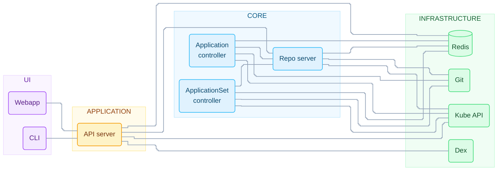
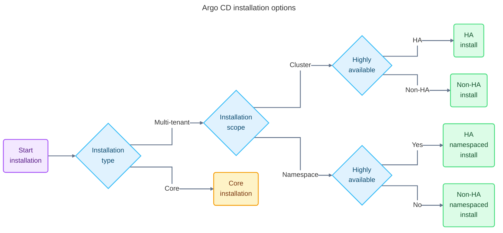

# Introduction
Argo Project has 4 main tools coupled in the same namespace Argo:
1. Argo Workflows: A cloud native workflow engine that is popular with AI/ML community.
2. Argo CD: A GitOps approach to managing and deploying applications on kubernetes at scale
3. Argo Rollout: An advanced progressive delivery controller that works hand in hand with Argo CD to help end users perform canary and blue-green deployments using their own Ingress/ServiceMesh controllers
4. Argo Events: A generic event bus with dependency management

# Installation
Argo comes in a microservice structure and its architecute is created in Pods using kubernetes primitive resources. Argo CD implements a Kubernetes controller pattern meaning it deploys a nonterminating control loop for managing and monitoring the desired state of at least one resource. Based on the defined configuration, the controller will ensure the current state matches the desired state. The properties that drive the core configurations of Argo CD are stored within `ConfigMaps` and `Secrets`, which include:
- Baseline Argo CD server details
- Connectivity details on external source repositories
- Security

Argo CD also registers a new API endpoint in Kubernetes API server to faciliate the management of it's resources. One of these resources that is called operator (a CRD or Custom Resource Definition) builds upon the primitive of a kubernetes controller for managing the current and desired state of resources in Kubernetes cluster and applies them to CRDs.

The Argo CD architecture looks like this:


# Custom Resources
Argo CD makes use of several CRDs to implement its GitOps management capabilities. Three custom resources are provided with each installation of Argo CD and these CRDs are used as our interface with Kubernetes cluster/clusters:
- Applications: a controller
- AppProjects
- ApplicationSets: a controller

Argo deploys a repository server that maintains a local cache)of the remote content source (either Git or Helm) using Redis that will be translated into kubernetes manifests.

The Argo API server is a gRPC/REST Api based server that handles the application management and status reporting, Syncing, rollback and other user-defined actions, cluster and repository management and RBAC enforcement.

Argo CD ships with a SSO and Notification integration in the newer versions outside the box. Argo CD is an stateless and declarative application meaning its state and configurations are set in ConfigMaps and Secrets and configurations and states can be rebuilt at any moment.

# Installing Argo CD
The following are the Argo CDs Installation types:


Argo CD in most cases will have multiple users that may span across multiple teams within an organization which is called the multi tenat installation. The next question we ask ourselves is whether we need the core and minimal amout of components which doesn't include the `UI`, `SSO` and the `API Server` and is optimized to consume a minimum amount of resources in a non HA available configuration. This installatiin is called `core installation` and is not multi tenant.

The next question is whether Argo CD has the authority to control resources across an entire kubernetes they are deployed within as well as any other cluster it may be managing externally. An approach is saying yes but another is called `namespaced` approach that allows Argo CD to only manage within  a specific namespace and is good for individual teams that want to have their own application and instance of Argo CD.

The last manner in installation is higher resiliancy in which each of Argo CD components can be configured in an optimized manner by increasing the `replica` count and making patches to the config files of each components.

# Deploying a Simple Installation
We can run the following command in order to install Argo from its GitHub repository:
```bash
kubectl create namespace argocd
kubectl apply -n argocd apply -f https://raw.githubusercontent.com/argoproj/argo-cd/stable/manifests/install.yml
```

We need a service to access the Argo CD from outside the cluster as well. 

We can then retrieve the initial admin password using the following command:
```bash
kubectl -n argocd get secret-argocd-initial-admin-secret -o \
    jsonpath="{.data.password}" | base64 -d; echo
```

## High Availability
In the previous installation we only have one pod and if one goes down the whole service is halted. There are othe sets of YAML files created for namespace or cluster-wide HA argocd.

# Installing Argo Using Helm
We can install Argo CD from it's helm package and we can add the repository and install Argo CD with the command that follows:
```bash
helm repo add argo https://argoproj.github.io/argo-helm
helm show values argo/argo-cd
helm upgrade -i argo-cd argo/argo-cd -n argocd --create-namespace
```

Either the helm install or helm upgrade command can be used to install the Argo CD chart. When the helm upgrade command is used with the -i parameter, Helm will check if there is an existing release found. If a release is not found, the chart will be installed instead of upgraded.
# Installing with Argo CD Operator
We can use the `OperatorHub` installation which configures Argo CD to expose APIs for Grafana and Prometheus.
