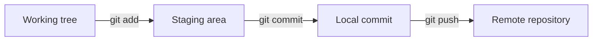
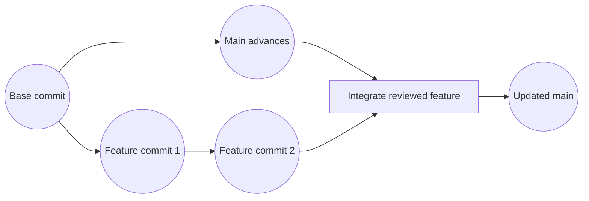
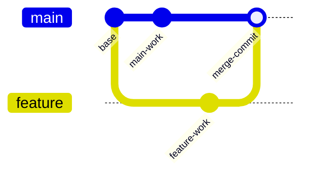

# Git for Argo CD
The following are a comprehensive guide to the commands used for source code management with Git and deploy with Argo CD.

# Git Model
Changes move from the working tree into the staging area, then into a local commit. The commit reaches the shared remote only when pushed.


# Branching and feature branch workflow
A feature branch starts at a base commit, advances independently and is integrated into the main branch after review.

# Three-way merge with a merge commit
When both branches have new commits, Git uses their common ancestor and records a merge commit with both branch tips as parent


# Inspecting History
```bash
git status                      # What changed and what is staged
git diff                        # Unstaged changes
git diff --staged               # Staged changes
git log --oneline --graph --decorate --all -20
git log -p path/to/file         # Patch history of a file
git show <commit>               # Full detail of one commit
git show <commit>:path/file     # A file as it existed at that commit
git blame path/to/file          # Who last changed each line
git branch -a                   # All branches, local and remote
git remote -v                   # Configured remotes
```

Finding where something went wrong:
```bash
git bisect start
git bisect bad                  # Current commit is broken
git bisect good <known-good>    # Git binary-searches commits; mark each tested one
git bisect reset                # Return to your branch when done
```

# Branches
```bash
git switch -c feature/x            # Create and switch to a new branch
git switch main                    # Switch to an existing branch
git branch -d feature/x            # Delete a merged branch
git branch -D feature/x            # Force-delete an unmerged branch (beware: commits may become unreachable)
git push origin --delete feature/x # Delete the branch on the remote
```

# Merge
In merge we go to the main that we want our feature to merge with and point to the branch we want to be merged with the main.
```bash
git switch main
git merge feature/x # merge feature branch into main
```

# Rebase
In rebase we switch to the feature branch and point to the main 

---
## Glossary
`Staging area`: A snapshot of changes you have marked to include in the next commit.
`Commit`: An immutable, signed by hash snapshot of the repository plus metadata (author, messagem parent).
`HEAD`: A pointer to the commit you have checked out; usually tip of your current branch.
`Branch`: A movable pointer to a commit. Creating a branch is cheap; it is just a name and a hash.
`Clone / fetch / push / pull`: Copy a repo, download new commits, upload commits, fetch plus integrate remote changes.
`Origin and Upstream`: `origin` is your fork's remote; `upstream` is commonly used for the original project you forked from.
`Merge`: Combine histories of two branches into one, producing a merge commit.
`Rebase`: Replay your commits on top of another branch, producing a linear history with new commit hashes
`Conflict`: Two branches changed the same lines and Git needs a human to decide the final content.
---