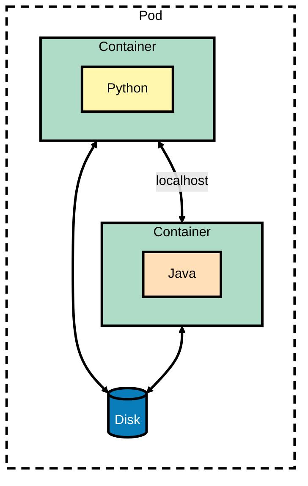
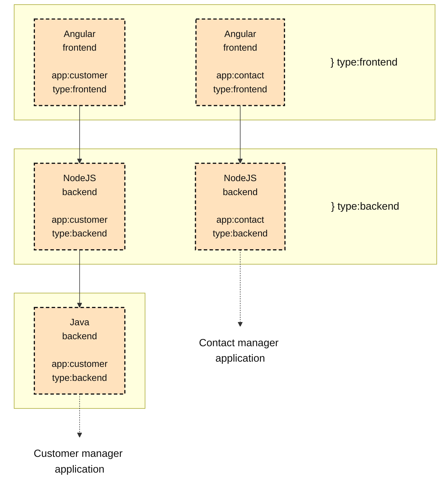
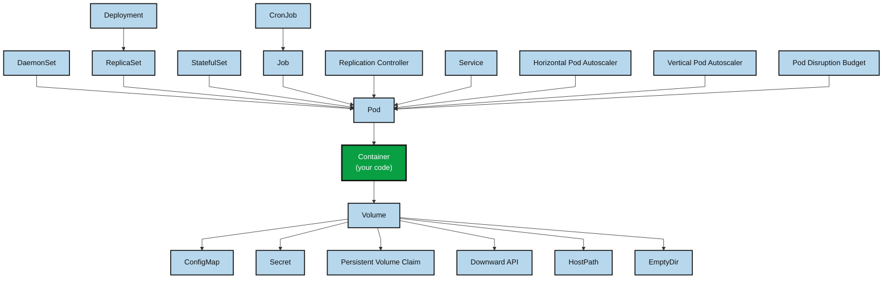

---
The following are the comparisons between the concept of K8S and OOP:

|                 Concept                 |           Local Primitive           |       Distributed Primitive       |
| :-------------------------------------: | :---------------------------------: | :-------------------------------: |
|       **Behavior Encapsulation**        |                Class                |          Container Image          |
|          **Behavior Instance**          |               Object                |             Container             |
|            **Unit of reuse**            |               `.jar`                |          Container Image          |
|             **Composition**             |      Class A contains Class B       |          Sidecar Pattern          |
|             **Inheritance**             |       Class A extends Class B       | A container's `FROM` parent image |
|           **Deployment Unit**           |        `.jar`/`.war`/`.ear`         |                Pod                |
|     **Buildtime/Runtime isolation**     |       Module, Package, Class        |     Namespace, Pod, Container     |
|    **Initialization Preconditions**     |            Constructors             |          Init container           |
|     **Postinitialization trigger**      |             Init-method             |            `postStart`            |
|         **Predestroy trigger**          |           Destroy-method            |             `preStop`             |
|          **Cleanup procedure**          |     `finalize()`,shutdown hook      |                 -                 |
| **Asynchronous and parallel execution** | `ThreadPoolExecutor`,`ForkJoinPool` |                Job                |
|            **Periodic task**            | `Timer`,`ScheduledExecutorService`  |             DaemonSet             |
|      **Configuration management**       |    `System.getenv()`, Properties    |         ConfigMap, Secret         |

---

# Pods:
- The atomic (smallest) unit of deployment
- Contains one or more container in which all containers are deployed on the same node and this is handled by `kube-scheduler`.
- All containers share a `localhost`network interface, IP, IPC (inter process communication)
- Pods are ephemeral and it's IP address is known only after it is scheduled and started on a node.
- Can Share a file system.
- If there are multiple containers in the same pod we must make sure the ports doesn't clash since since the IP address, name and port range are shared with the containers in the same pod.
---
# Services
- Pods IP addresses will change after the pod goes down and it is rescheduled.
- Acts as a named entry point to access an application and an IP and port is assigned to it that will survive rescheduling.
---
# Labels
- Labels define a way to indicate some microservices (application or service) belong together.
- We can add multiple labels to define functionality, type, group and more.
- Using labels gives us the ability to query and identify a set of pods and manage it as one logical unit.
- Labels are used by ReplicaSets to keep some instances of a specific pod running so every pod definition needs to have a unique combination of labels.
- Labels are used by scheduler to colocate or spread pods to nodes that satisfy the pod's requirements.
---
# Annotations
- Just like labels these are organized as a map (key-value pair) but are intended for specifying nonsearchable metadata and are for machine usage.
- Annotations are used to attach additional metadata to objects from various tools, plugins and libraries.
---
# Namespaces
- Namespace is a kubernetes resource that allow us to divide the cluster into a logical pool of resources, allowing mechanism to apply authorizations and policies to a subsection of cluster.
- Namespaces are managed as a kubernetes resource and provides a scope for other resources such as pods, services and ReplicaSets.
- By default different namespaces can access each others resources but a divided multitenancy can be achieved with network isolation.
- Not all resources can belong to a specific namespace like PersistentVolumes.
- All kubernetes services receive a DNS name that has the following pattern:
```text
<service name>.<namespace name>.svc.cluster.local
```
for example `nginx.production.svc.cluster.local`.
- Namespace can have `ResourceQuotas` to provide constraints that limit the aggregated resource consumption per namespace. This quotas can be based on count of object type like 5 ConfigMaps or resources like RAM.

---
# Kubectl
- In order to check what file is used in the CoreDNS to query its database we can use the following command:
```bash
kubectl get configmap coredns -n kube-system -o yaml
```

- Label a node to have the `gpu=enabled` label and if it was set before overwrite it:
```bash
kubectl label node worker-1 gpu=enabled # initial set
kubectl label node worker-1 gpu=enabled --overwrite # overwrite
kubectl label node worker-1 --show-labels
```

---
# Diagrams
## Side Car Pattern

## Labels


## Object Relations

